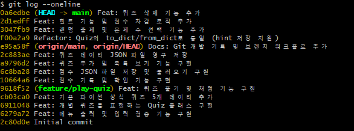
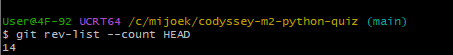
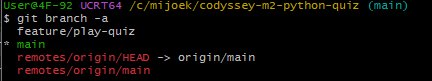
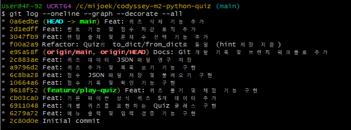
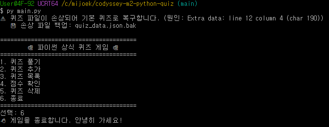

# 🧠 파이썬 상식 퀴즈 (CLI)

## 1. 프로젝트 개요

파이썬 상식 문제를 풀고 점수를 기록하는 커맨드라인(CLI) 퀴즈 프로그램입니다.
사용자는 퀴즈를 풀고, 직접 문제를 추가·삭제하며, 자신의 점수 기록을
날짜별로 확인할 수 있습니다. 퀴즈와 점수는 JSON 파일에 영구 저장되어
프로그램을 다시 실행해도 데이터가 유지됩니다.

## 2. 퀴즈 주제 선정 이유

파이썬을 처음 배우는 사람이 **핵심 상식을 재미있게 복습**할 수 있도록
파이썬 기초 상식을 주제로 선정했습니다. 단순히 읽는 공부보다
직접 문제를 풀어보면 기억에 더 오래 남고, 힌트·점수 기능을 통해
학습 동기를 높일 수 있다고 생각했습니다.

## 3. 개발 환경

| 항목 | 사용 환경 |
|---|---|
| 프로그래밍 언어 | Python 3.10 이상 |
| 개발 도구 | Visual Studio Code |
| 운영 환경 | Windows / PowerShell |
| 버전 관리 | Git |
| 원격 저장소 | GitHub |
| 데이터 저장 | JSON |
| 라이브러리 | Python 표준 라이브러리 |

## 4. 실행 방법

### 4-1. 저장소 복제

```bash
git clone https://github.com/mijoekim/codyssey-m2-python-quiz.git
```

### 4-2. 프로젝트 폴더 이동

```bash
cd codyssey-m2-python-quiz
```

### 4-3. 프로그램 

```bash
py main.py
```
실행 후 메뉴 번호를 입력해 원하는 기능을 선택합니다.

## 5. 기능 목록

### 5-1. 기본 기능
- 퀴즈 풀기 및 자동 채점
- 새로운 퀴즈 추가
- 등록된 퀴즈 목록 조회
- 퀴즈 삭제
- 점수 기록 저장 및 조회
- 프로그램 종료

### 5-2. 보너스 기능
- 🎲 **랜덤 출제**: 매번 다른 순서로 문제 출제
- 🔢 **문제 수 선택**: 풀고 싶은 문제 개수를 직접 선택
- 💡 **힌트 기능**: 힌트를 보면 점수가 일부 차감
- 🗑️ **퀴즈 삭제**: 번호를 골라 퀴즈 삭제 (파일에 반영)
- 📊 **점수 히스토리**: 날짜/시간·문제 수·점수를 영구 저장

## 6. 파일 구조


```
.
├── main.py          # 프로그램 실행 및 메뉴 관리
├── quiz.py          # Quiz 클래스 정의 (to_dict/from_dict 지원)
├── quiz_data.py     # 기본 퀴즈 데이터, 추가/삭제/목록, JSON 저장·불러오기
├── game.py          # 퀴즈 풀이 및 채점 로직 (랜덤·힌트 포함)
├── score.py         # 점수 기록 저장/불러오기
├── quiz_data.json   # 저장된 퀴즈 데이터
├── scores.json      # 저장된 점수 기록
├── docs/            # 스크린샷 등 문서 자료
└── README.md
```

## 6.1 데이터 파일 설명

프로그램은 두 개의 JSON 파일에 데이터를 영구 저장합니다.

### `quiz_data.json` — 퀴즈 데이터
등록된 모든 퀴즈 문제를 저장합니다. 퀴즈를 추가·삭제하면
이 파일에 자동으로 반영됩니다.

```json
[
  {
    "question": "파이썬을 만든 사람은 누구일까요?",
    "choices": [
      "귀도 반 로섬",
      "제임스 고슬링",
      "리누스 토르발스",
      "비야네 스트롭스트룹"
    ],
    "answer": 1,
    "hint": "네덜란드 출신 프로그래머입니다."
  },
  {
    "question": "파이썬에서 리스트를 만들 때 사용하는 괄호는?",
    "choices": [
      "( )",
      "{ }",
      "[ ]",
      "< >"
    ],
    "answer": 3,
    "hint": "대괄호입니다."
  },
  {
    "question": "다음 중 파이썬의 자료형이 아닌 것은?",
    "choices": [
      "int",
      "float",
      "char",
      "str"
    ],
    "answer": 3,
    "hint": "파이썬에는 문자 하나만을 위한 전용 타입이 없습니다."
  },
  {
    "question": "파이썬에서 True와 False를 나타내는 자료형의 이름은?",
    "choices": [
      "boolean",
      "bit",
      "bool",
      "binary"
    ],
    "answer": 3,
    "hint": "4글자로 줄여서 부릅니다."
  }
]
```


### `scores.json` — 점수 기록
퀴즈를 풀 때마다 날짜/시간, 푼 문제 수, 획득 점수가 저장되어
히스토리로 조회할 수 있습니다.

```json
[
  {
    "score": 5,
    "total": 5,
    "date": "2026-11-11 14:04"
  },
  {
    "score": 2,
    "total": 2,
    "date": "2026-11-11 16:42"
  },
  {
    "score": 5,
    "total": 5,
    "date": "2026-11-11 16:43"
  },
  {
    "score": 1.0,
    "total": 2,
    "date": "2026-11-11 17:01"
  }
]
```


## 👤 만든 사람

mijoekim


## 7. Git 및 GitHub 버전 관리

Git과 GitHub를 활용하여 프로젝트 소스 코드를 관리했습니다.

- Git 저장소 초기화 및 원격 저장소 연결
- 기능별 커밋을 통한 변경 이력 관리
- 기능 개발 브랜치 생성
- 브랜치 작업 후 기본 브랜치에 병합
- GitHub 원격 저장소에 프로젝트 업로드
- `git clone`을 이용한 저장소 복제
- `git pull`을 이용한 원격 저장소 변경사항 가져오기

### 7-1. 커밋 메시지 작성 규칙

커밋 메시지는 변경 목적을 쉽게 파악할 수 있도록 다음 형식을 사용합니다.

```text
type: 변경 내용 요약
```

주요 접두사는 다음과 같습니다.

| 접두사 | 사용 목적 | 예시 |
|---|---|---|
| feat | 새로운 기능 추가 | feat: 퀴즈 플레이 기능 추가 |
| fix | 오류 수정 | fix: 메뉴 입력 오류 수정 |
| docs | 문서 수정 | docs: README 설명 보완 |
| refactor | 코드 구조 개선 | refactor: 퀴즈 데이터 처리 개선 |
| test | 테스트 추가 및 수정 | test: 퀴즈 입력 검증 테스트 |
| chore | 설정 및 기타 작업 | chore: gitignore 설정 추가 |

커밋 메시지는 한 커밋에서 변경한 핵심 내용을 간결하게 작성합니다.

### 7-2. 커밋 기록 확인

다음 명령어로 커밋 기록을 확인할 수 있습니다.

```bash
git log --oneline
```


전체 커밋 수를 확인하려면 다음 명령어를 사용합니다.

```bash
git rev-list --count HEAD
```

```
User@4F-92 UCRT64 /c/mijoek/codyssey-m2-python-quiz (main)
$ git rev-list --count HEAD
15

```


### 7-3. 브랜치 및 병합 기록 확인

브랜치 목록 확인:

```bash
git branch -a
```



브랜치 병합을 포함한 전체 커밋 그래프 확인:

```bash
git log --oneline --graph --decorate --all
```



실제 브랜치 생성과 병합을 통해 기능 개발 이력을 관리했습니다.


### 7-4. GitHub 저장소

GitHub 저장소:

https://github.com/mijoekim/codyssey-m2-python-quiz


## 8. 기술 선택 이유

### 8-1. 왜 클래스(OOP)를 사용했나? (Quiz 클래스)
퀴즈 한 개는 '질문 + 선택지 + 정답 + 힌트'가 항상 함께 다녀야 하는
데이터 묶음입니다. 이를 딕셔너리로 다루면 키 오타·구조 불일치가 생기기 쉽습니다.
`Quiz` 클래스로 묶으면 다음 이점이 있습니다.

- 관련 데이터와 동작(`show`, `is_correct`)을 한 곳에 모을 수 있음
- `to_dict`/`from_dict`로 저장·복원 규칙을 클래스가 직접 관리
- 새 속성(예: 난이도) 추가 시 한 클래스만 수정하면 됨

### 8-2. 왜 JSON으로 저장했나?
- **가독성**: 사람이 직접 열어 읽고 수정할 수 있는 텍스트 형식
- **구조화**: 선택지 리스트처럼 중첩 구조를 그대로 표현 가능
- **표준 라이브러리**: 추가 설치 없이 `json` 모듈로 처리 가능
- 퀴즈·점수처럼 규모가 작고 구조가 단순한 데이터에 적합

### 8-3. 파일(로직) 분리 기준
| 책임 | 담당 파일 |
|------|----------|
| 화면 흐름·메뉴 제어 | `main.py` |
| 데이터 모델 | `quiz.py` |
| 퀴즈 데이터 입출력·관리 | `quiz_data.py` |
| 퀴즈 진행·채점 | `game.py` |
| 점수 입출력·관리 | `score.py` |

입력 흐름(`main.py`)과 데이터 입출력(`quiz_data.py`, `score.py`)을
분리하여, 저장 방식이 바뀌어도 메뉴 코드는 영향을 받지 않도록 했습니다.

## 9. 데이터 저장 방식의 한계와 대응

### 9-1. JSON 저장의 한계
- 저장할 때마다 **파일 전체를 다시 쓰므로**, 데이터가 매우 많아지면
  속도·메모리 면에서 비효율적입니다.
- 동시에 여러 곳에서 쓰면 데이터가 꼬일 수 있습니다.
- 대규모·동시접근이 필요하다면 **SQLite 같은 데이터베이스**가 더 적합합니다.
  (현재 프로젝트는 소규모 CLI이므로 JSON으로 충분합니다.)

### 9-2. 파일 손상 시 대응
현재는 파일이 **없을 때**(`FileNotFoundError`)만 처리하여,
퀴즈 파일은 기본 데이터로 복구하고 점수 파일은 빈 기록으로 시작합니다.

JSON **내용이 손상된 경우**(파싱 오류)에 대한 개선 방향:
- 읽기 시 `json.JSONDecodeError`도 함께 처리
- 손상 파일을 `.bak`으로 백업한 뒤 초기값으로 재시작

